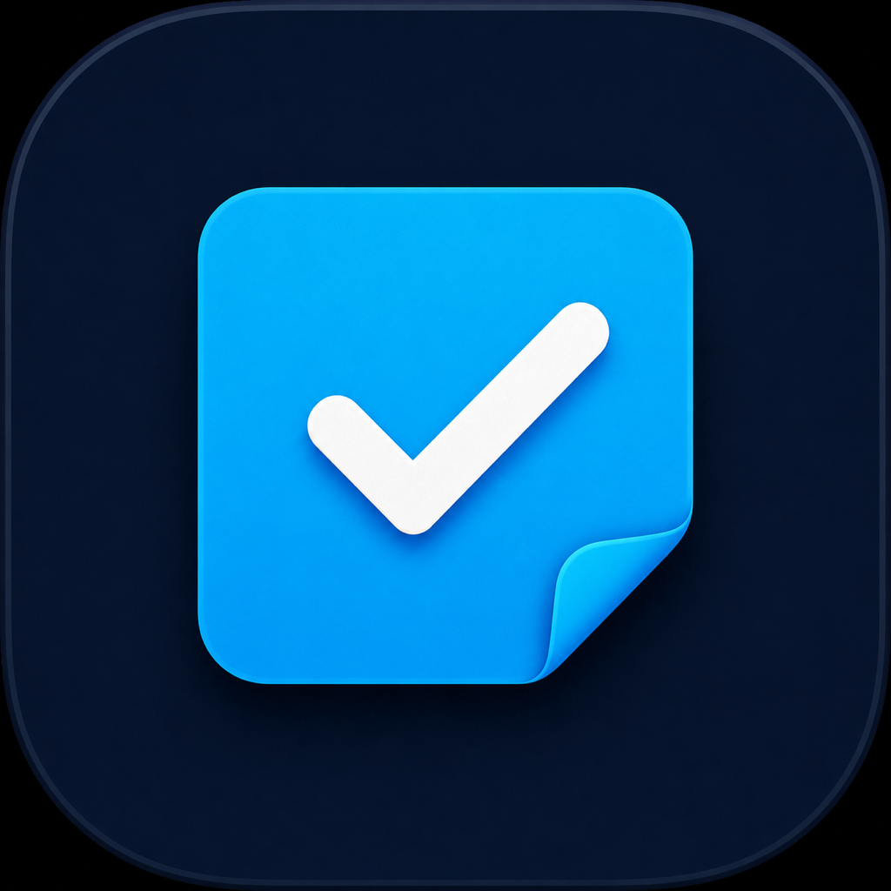

# Session Todo




[](LICENSE)

## TL;DR — try it

### [⬇ Download Session Todo for Mac](https://github.com/haramrit09k/sticky-todo-macos/releases/latest/download/Session-Todo-macOS.dmg)

Works on any Mac with macOS 13 or newer, Apple Silicon or Intel. Open the DMG, drag **Session Todo** into **Applications**, and open it. Press `⌘⇧Space` anytime to hide or bring it back.

The first time, macOS will block it because I have not paid for Apple's notarization. Go to **System Settings → Privacy & Security** and click **Open Anyway**. You only do this once. [More detail →](#download-and-install)

Prefer Terminal? This installs it without the security prompt:

```bash
curl -fsSL -o /tmp/Session-Todo.zip https://github.com/haramrit09k/sticky-todo-macos/releases/latest/download/Session-Todo-macOS.zip && ditto -x -k /tmp/Session-Todo.zip /Applications && open "/Applications/Session Todo.app"
```

**Quick start:** add one small task, work from the card marked **NOW**, and check it off when you are done. [See the short usage guide →](#how-to-use-it)

I made this because I kept opening a task, getting distracted by something else, and then forgetting what I had originally sat down to do.

Session Todo is a small floating todo list for macOS. It is not meant to replace Things, Reminders, Linear, or whatever you use for planning. It is just for the current work session—the handful of things you are actually trying to get done right now.

The first unfinished task stays visually obvious. Everything else can be tucked away until you need it.

## Why this exists

Most todo apps are good at storing work. I wanted something better at reminding me what I was doing five minutes ago.

The problem usually looks like this:

1. Start working on something.
2. Open a browser to look up one small detail.
3. End up six tabs deep in a completely different problem.
4. Eventually wonder what I was supposed to be doing.

This app leaves the answer one shortcut away.

## What it does

- Keeps one **NOW** task front and center.
- Hides the rest of the backlog unless you ask to see it.
- Opens or hides with `⌘⇧Space` from anywhere on the Mac.
- Lives in the menu bar when the window is hidden.
- Lets you edit a task directly by clicking its text.
- Lets you drag tasks to reorder them (expand the backlog first).
- Gives you a few seconds to undo an accidental edit, delete, reorder, or completion.
- Can send an occasional silent nudge asking if you are still on the current task.
- Stores everything locally. No account and no sync.

There are intentionally no projects, labels, due dates, streaks, productivity scores, or dashboards.

## Download and install

Every [release](https://github.com/haramrit09k/sticky-todo-macos/releases/latest) includes a disk image (`Session-Todo-macOS.dmg`) and a zip (`Session-Todo-macOS.zip`) of the same app. It is a single universal build that runs on every Mac with macOS 13 or newer, Apple Silicon (M1 and later) and Intel alike.

I do not have a paid Apple Developer account, so the app is not notarized by Apple. macOS will refuse to open it the first time, with a message like *“Apple could not verify ‘Session Todo’ is free of malware.”* That is expected. The app is built in the open by [GitHub Actions](.github/workflows/release.yml) from the code in this repo.

### Option A: Download the DMG

1. Download **[Session-Todo-macOS.dmg](https://github.com/haramrit09k/sticky-todo-macos/releases/latest/download/Session-Todo-macOS.dmg)**.
2. Open it and drag **Session Todo** onto the **Applications** shortcut next to it.
3. Open Session Todo from Applications. macOS will block it the first time. Click **Done** (not “Move to Trash”).
4. Open **System Settings → Privacy & Security**, scroll down to the message about Session Todo, and click **Open Anyway**. Confirm with your password or Touch ID.

You only need to do this once. On macOS 13 and 14 you can also right-click the app, choose **Open**, then **Open** again.

If macOS says the app is “damaged and can’t be opened,” clear the download flag and try again:

```bash
xattr -dr com.apple.quarantine "/Applications/Session Todo.app"
```

### Option B: Terminal (no security prompt)

```bash
curl -fsSL -o /tmp/Session-Todo.zip https://github.com/haramrit09k/sticky-todo-macos/releases/latest/download/Session-Todo-macOS.zip
ditto -x -k /tmp/Session-Todo.zip /Applications
open "/Applications/Session Todo.app"
```

Files downloaded with `curl` are not marked as “from the internet,” so macOS opens the app without the warning.

### No admin rights?

If you cannot write to `/Applications` (common on work Macs), use your personal Applications folder instead:

```bash
mkdir -p ~/Applications
curl -fsSL -o /tmp/Session-Todo.zip https://github.com/haramrit09k/sticky-todo-macos/releases/latest/download/Session-Todo-macOS.zip
ditto -x -k /tmp/Session-Todo.zip ~/Applications
open ~/Applications/"Session Todo.app"
```

Some company-managed Macs block apps that are not notarized entirely. If so, ask your IT team.

## Build from source

You need macOS 13.5 or newer and Xcode 15 (or its Command Line Tools) or later.

If you do not have the command-line tools yet:

```bash
xcode-select --install
```

Then clone and install the app:

```bash
git clone https://github.com/haramrit09k/sticky-todo-macos.git
cd sticky-todo-macos
./install.sh
```

That builds the app, copies it to `/Applications/Session Todo.app`, and opens it.

If you would rather not install it yet:

```bash
./build.sh
open "outputs/Session Todo.app"
```

`./build.sh` compiles for your Mac's chip. `./build.sh --universal` builds one app for both Apple Silicon and Intel, which is what the releases use.

## How to use it

Type a concrete next step and press Return. Smaller tasks work better than vague ones—“write the intro paragraph” is more useful than “finish website.”

- Click the checkbox to complete a task.
- Click the task text or pencil to edit it. Return saves; Escape cancels.
- Expand **Show later** to see the backlog.
- Drag a task card to reorder it, or use the small up arrow.
- Press `⌘⇧Space` to hide or bring back the window.
- The `×` hides the window. It does not quit the app.
- Use `⌘Q` or the menu-bar menu when you actually want to quit.

## Nudges

The optional nudge feature sends a silent notification at a random point between 20 and 35 minutes, as long as you have an unfinished task.

It asks whether you are still working on the current task. **Yep** dismisses it. **Got distracted** brings the window back.

I made the timing slightly random because a perfectly predictable reminder is very easy to dismiss without thinking. That said, notifications can also become noise, so nudges can be turned off from the checkmark icon in the menu bar.

## Launch at login

There is a **Launch at login** toggle in the menu-bar menu. Install the app in `/Applications` before enabling it; macOS may reject login-item registration for a build running from another folder.

## Privacy

Tasks are saved with macOS `UserDefaults` on your own computer. The app does not make network requests and does not include analytics or telemetry.

Notifications are scheduled locally by macOS.

## Building / hacking on it

This is a deliberately small native Swift/AppKit app. There are no third-party dependencies.

```bash
./build.sh
```

The main code is in `Sources/SessionTodo/main.swift`. The build script compiles it with `swiftc`, creates the `.app` bundle in `outputs/`, and applies an ad-hoc signature.

### Publishing a release

Push a version tag and GitHub Actions does the rest:

```bash
git tag v1.0.0
git push origin v1.0.0
```

Creating a release with a new `v*` tag on GitHub's Releases page works too. The [release workflow](.github/workflows/release.yml) builds the universal app on a macOS runner, packages it as `Session-Todo-macOS.dmg` and `Session-Todo-macOS.zip` with SHA-256 checksums, and attaches them to the release. To rebuild the downloads for an existing release, open **Actions → Release → Run workflow** and enter its tag. Every push and pull request also runs a [build check](.github/workflows/build.yml).

The app uses:

- AppKit for the UI and floating window
- Carbon for the global shortcut
- UserNotifications for the focus check-ins
- ServiceManagement for launch at login

The code is still fairly compact and a little scrappy in places. Issues and small improvements are welcome.

## License

MIT. See [LICENSE](LICENSE).
